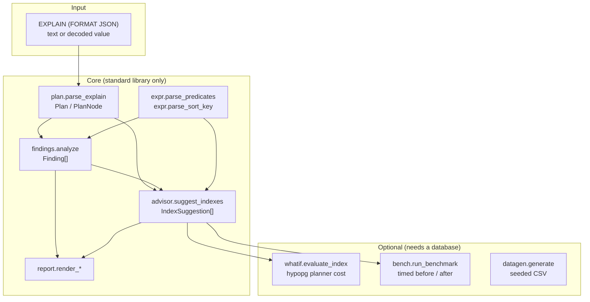
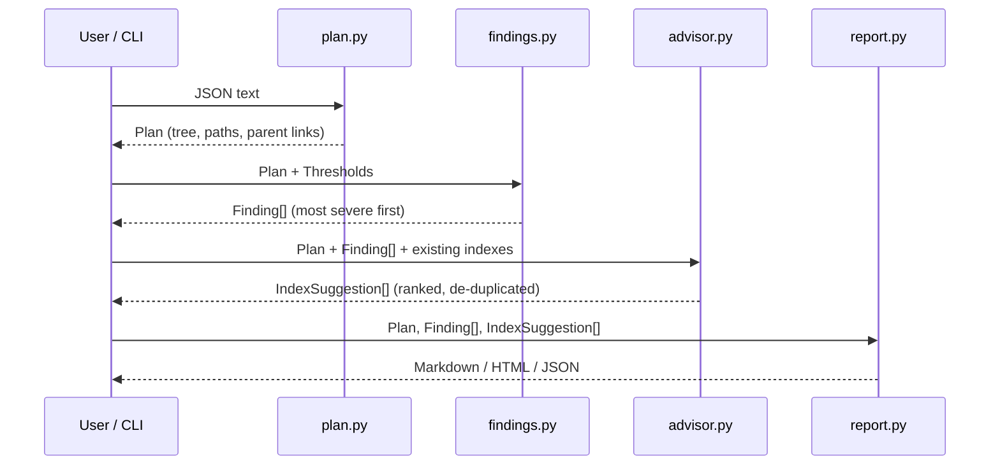

# Planlens architecture

Planlens is a small pipeline: **parse → detect → suggest → render**. Each stage is a pure function over plain data, so every stage can be tested with fixtures and no database.

## Data flow

## Modules

| Module | Responsibility | Notes |
|---|---|---|
| `plan.py` | Parse EXPLAIN JSON into `Plan` and `PlanNode`; build a readable, unique `path` for each node (`Nested Loop > Seq Scan on order_items i (inner)`; siblings that would share a path get ` #1`, ` #2`) | Raises `PlanParseError` for any malformed input; row counts keep Postgres's per-loop meaning |
| `expr.py` | Read `Filter`, `Join Filter` and `Sort Key` strings into `Predicate` and `SortKey` | Tolerant text reader; unsupported shapes become `expression`, `or` or `other` and are never turned into index columns |
| `findings.py` | Six detectors plus `Thresholds` | Each detector is `(Plan, Thresholds) -> list[Finding]`; add one by appending to `DETECTORS` |
| `advisor.py` | Turn findings into btree index suggestions | Column order, de-duplication, prefix elimination, existing-index suppression, DDL, naming, quoting |
| `report.py` | Render Markdown, HTML (escaped) or JSON | Every report carries the score note and a disclaimer |
| `whatif.py` | Compare planner cost with and without a hypothetical index (hypopg) | Cursor protocol, so it is testable without a server; read-only queries only |
| `bench.py` | Time a query before and after its index | Autocommit connection; always drops the index it created; validates DDL and queries |
| `datagen.py` | Seeded CSV generator for the demo schema | Same `(scale, seed)` gives the same bytes |
| `cli.py` | `analyze`, `gen`, `bench` | Exit code 2 on bad input |

## How the advisor chooses columns

1. **Sequential scan with a filter:** equality columns first (in the order they appear), then at most one range column. A second range column cannot narrow a btree scan further.
2. **Nested loop with an unindexed inner scan:** the inner table's join column(s) from the join condition, followed by any equality filters on that table.
3. **Spilled sort over one table:** the sort keys in order, with `DESC` preserved.

Candidates that are a strict prefix of another candidate on the same table are dropped, because the longer index serves the same lookups. A candidate already covered by an existing index (`--existing table:col,col`) is dropped. Suggestions are ranked by a heuristic score: the share of the plan's total cost under the affected node, scaled by the fraction of rows discarded. Estimated (non-ANALYZE) findings are halved.

## Safety decisions

- **Generated SQL is quoted.** Identifiers come from plan text, which is untrusted input, so they pass through `quote_ident`. DDL is printed for a human to run; Planlens never executes suggested DDL itself.
- **The benchmark harness runs only plain `CREATE INDEX` statements** on one table, and only plain read-only queries (data-modifying and locking keywords outside string literals are rejected, because `EXPLAIN ANALYZE` executes the statement). Anything else is rejected before a connection is used. The index is dropped in a `finally` block, qualified with the table's schema, even if `ANALYZE` or a timed run fails. It requires `--yes` because it creates and drops indexes.
- **HTML output escapes all plan-derived text.**
- **The hypopg adapter accepts a single read-only statement** and uses plain `EXPLAIN`, so nothing is executed.

## Extending

- **A new detector:** write `detect_x(plan, limits) -> list[Finding]`, add it to `DETECTORS`, add a hand-written fixture and a test.
- **A new suggestion source:** add a `_from_x` function in `advisor.py` and handle its finding code in `suggest_indexes`.
- **Another output format:** add a `render_*` function and register it in `cli.RENDERERS`.

## Decisions

- [ADR 0001: heuristics before hypopg](adr/0001-heuristics-before-hypopg.md)
- [ADR 0002: parse EXPLAIN JSON, not text](adr/0002-parse-explain-json-not-text.md)
- [ADR 0003: standard-library core](adr/0003-standard-library-core.md)
- [ADR 0004: hand-written plan fixtures](adr/0004-hand-written-plan-fixtures.md)
