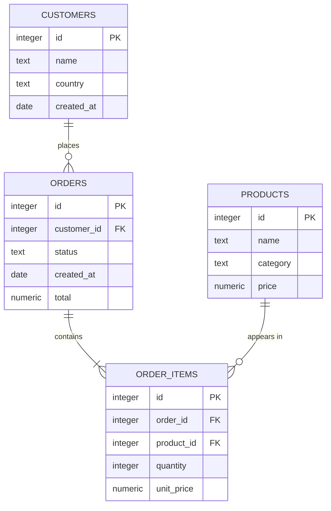

# Demo data model

The schema in [`sql/schema.sql`](../sql/schema.sql) is a small order-management model used by the data generator and the benchmark queries. It has primary keys and foreign keys but **no secondary indexes**, so the example queries have something for Planlens to find.

## Generated data

`planlens gen --scale S --seed N` writes four CSV files. The same arguments always produce identical files.

| Table | Rows at scale 1.0 | Notes |
|---|---|---|
| `customers` | 10,000 | Country drawn from 8 values |
| `products` | 500 | 8 categories; price between 5.00 and 499.99 |
| `orders` | 100,000 | Status weights: open 5, paid 20, shipped 70, cancelled 5; dates over a 730-day span from 2023-01-01 |
| `order_items` | about 300,000 | 1 to 5 items per order; `orders.total` equals the sum of its items |

Every table has at least one row at any positive scale, and every foreign key refers to an existing row.

The status weights make `status = 'open'` selective (about 5% of orders), which is what the `open_orders_recent` query relies on.

## Index each example expects

| Query file | Index it compares against |
|---|---|
| `open_orders_recent.sql` | `orders (status, created_at)` |
| `customer_orders.sql` | `orders (customer_id)` |
| `order_items_join.sql` | `order_items (order_id)` |
| `recent_orders_sorted.sql` | `orders (created_at DESC)` |
| `category_price_filter.sql` | `products (category, price)` (small table; a scan may remain the better plan) |
